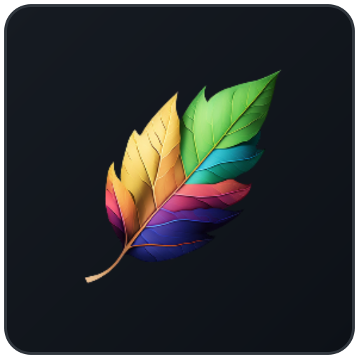

<div align="center">



# Foliate

**A starting point for Minecraft plugins on Folia, built the way Folia requires.**

[](https://github.com/pkhemae/foliate/actions/workflows/build.yml)
[](LICENSE)


[Documentation](https://github.com/pkhemae/foliate/wiki) · [Getting started](https://github.com/pkhemae/foliate/wiki/Getting-started) · [Issues](https://github.com/pkhemae/foliate/issues)

</div>

Foliate is a template for plugins that run on [Folia](https://github.com/PaperMC/Folia). It gives
you the parts every plugin needs, already written for Folia's threading model, so you start from
working code. New to Folia? Read its [overview](https://docs.papermc.io/folia/reference/overview/)
first. The same jar runs on Paper.

## Features

| Area | What you get |
| --- | --- |
| **Scheduling** | One facade over Folia's region, entity, global and async schedulers |
| **Modules** | Features with an enable, reload and disable lifecycle, isolated from each other |
| **Configuration** | A typed `config.yml`, generated with comments, reloaded safely, migrated between versions |
| **Messages** | MiniMessage text in one `messages.yml`, in English, that the server translates by editing it |
| **Commands** | One class per subcommand, on Paper's native command API, with declared permissions |
| **Storage** | SQLite out of the box, MySQL or MariaDB by configuration, with schema migrations |
| **Player data** | Loaded before login, cached, saved in order, retried while the database is unreachable, flushed on shutdown |
| **Scoreboard** | A per-player scoreboard on the side of the screen, drawn with packets because the Bukkit scoreboard API does not work on Folia |
| **Integrations** | PlaceholderAPI and zMenu, both optional |
| **Tests** | Unit tests, a smoke test that boots a real Folia server, and a headless Minecraft client that joins it, in CI |
| **Tooling** | One command to rename the template, GitHub releases on tag with a SHA-256 checksum, Renovate |

What you keep is `core/`, the plugin class and the `info` and `reload` commands. Everything under `modules/` and `hooks/`, with the subcommands each feature offers, is example code that you can delete: the [developer guide](https://github.com/pkhemae/foliate/wiki/Making-it-yours) lists what each removal takes with it. `contracts/` is empty, apart from its `package-info.java`: it is where your features put what they offer each other.

## Quick start

Clone or fork this repository, then make it yours:

```bash
./gradlew renameTemplate -PnewName=Skylands -PnewGroup=com.example.skylands -PnewRepository=you/skylands
```

Build it:

```bash
./gradlew build
```

Run it on a local Folia server, with PlaceholderAPI and zMenu installed for you:

```bash
./gradlew runFolia
```

The server asks you to accept the Minecraft EULA in `run/eula.txt` on first start. The jar to
install elsewhere is the one in `build/libs/` without `-plain` in its name.

## Documentation

The [wiki](https://github.com/pkhemae/foliate/wiki) has one page per topic.

| Start here | Guides |
| --- | --- |
| [Getting started](https://github.com/pkhemae/foliate/wiki/Getting-started) | [Architecture](https://github.com/pkhemae/foliate/wiki/Architecture) · [Modules](https://github.com/pkhemae/foliate/wiki/Modules) · [Commands](https://github.com/pkhemae/foliate/wiki/Commands) · [Events](https://github.com/pkhemae/foliate/wiki/Events) · [Configuration](https://github.com/pkhemae/foliate/wiki/Configuration) · [Messages](https://github.com/pkhemae/foliate/wiki/Messages) |
| [Folia for Bukkit developers](https://github.com/pkhemae/foliate/wiki/Folia-for-Bukkit-developers) | [Scheduling](https://github.com/pkhemae/foliate/wiki/Scheduling) · [Storage and player data](https://github.com/pkhemae/foliate/wiki/Storage-and-player-data) · [Placeholders](https://github.com/pkhemae/foliate/wiki/Placeholders) · [Menus](https://github.com/pkhemae/foliate/wiki/Menus) · [Scoreboard](https://github.com/pkhemae/foliate/wiki/Scoreboard) |
| [Making it yours](https://github.com/pkhemae/foliate/wiki/Making-it-yours) | [Optional integrations](https://github.com/pkhemae/foliate/wiki/Optional-integrations) · [Testing](https://github.com/pkhemae/foliate/wiki/Testing) · [Debugging](https://github.com/pkhemae/foliate/wiki/Debugging) · [Releasing](https://github.com/pkhemae/foliate/wiki/Releasing) |

## Requirements

| Requirement | Version |
| --- | --- |
| Server | Folia or Paper 26.2 |
| Java | 25, downloaded by Gradle if missing |
| Optional plugins | PlaceholderAPI 2.12.3+, zMenu 1.1.2.1+ |

## Status

Foliate is at version 0.1.0-SNAPSHOT and has no release yet. CI runs its unit tests, a smoke test on a
real Folia 26.2 server, jobs that join that server with a headless Minecraft client, and the storage
tests on MySQL and MariaDB. What each of them checks, and what none of them can see, is in the
[Testing](https://github.com/pkhemae/foliate/wiki/Testing) page of the guide.

## Contributing

Contributions are welcome: see [CONTRIBUTING.md](CONTRIBUTING.md). Changes are listed in the
[changelog](CHANGELOG.md).

## License

[MIT](LICENSE). The libraries bundled in the plugin jar keep their own licenses, listed in
[THIRD-PARTY-NOTICES](THIRD-PARTY-NOTICES), which the jar carries too. PlaceholderAPI and zMenu are
separate plugins under their own licenses and are not bundled.
